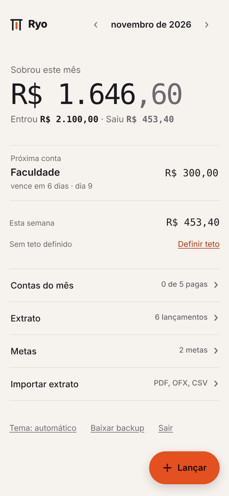
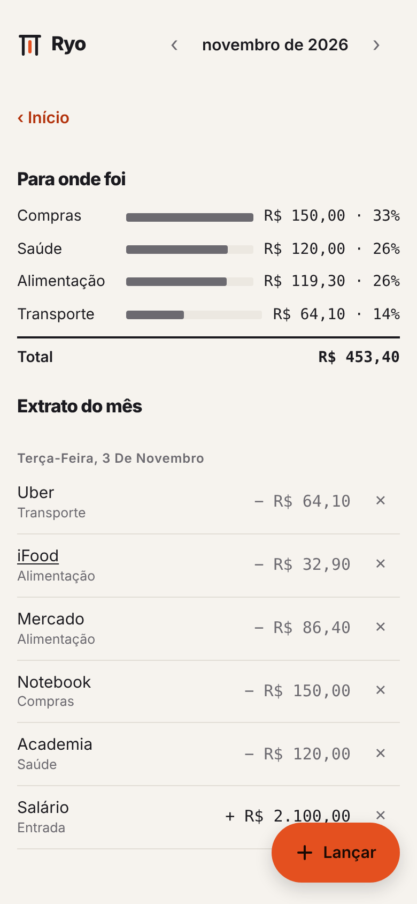
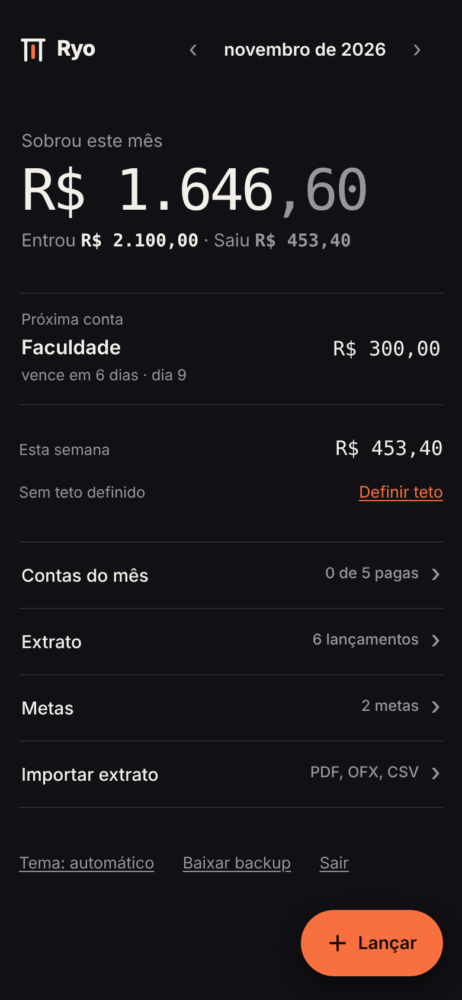

<p align="center">
  
</p>

<h1 align="center">Ryo</h1>

<p align="center">
  <b>Personal Finance</b><br>
  Entrou. Saiu. Sobrou.
</p>

<p align="center">
  <a href="https://lipefp.github.io/ryo/">Abrir no navegador</a> ·
  <a href="https://github.com/lipefp/ryo/releases/tag/apk">Baixar o app Android</a>
</p>

<p align="center">
  
  
  
  
</p>

Controle financeiro pessoal feito pra abrir e entender o mês em poucos segundos: quanto entrou, quanto saiu e quanto sobrou na conta. Sem gráfico difícil e sem precisar anotar cada detalhe.

## O nome

Ryo (両) foi a moeda de ouro do Japão no período Edo. O ideograma também quer dizer "os dois lados". O app mostra os dois lados do dinheiro, o que entra e o que sai, e o que sobra no meio. Fala-se "Riô".

## O que ele faz

**No dia a dia**
- Lança entradas, gastos, valores guardados e pagamento de fatura
- Mostra a próxima conta a vencer logo na tela inicial
- Acompanha um teto de gastos por semana

**Contas e cartão**
- Contas do mês com vencimento, inclusive "5º dia útil" (pula fim de semana e feriado)
- Contas só de lembrete, pagas com dinheiro de outra conta, que não mexem na sobra
- Compra no cartão conta como gasto no dia da compra e só sai da conta quando a fatura é paga
- Parcelamentos: as próximas parcelas aparecem sozinhas nos meses certos

**Organização**
- Metas com valor, prazo e quanto guardar por mês
- Extrato do mês separado por categoria
- Importa extrato da conta e fatura do cartão em PDF (testado com Santander), OFX e CSV, sem duplicar o que já foi lançado
- Aprende suas categorias: corrigiu uma vez, ele acerta das próximas
- Lançamento automático pelas notificações do banco no celular
- Tema claro e escuro, backup em JSON

## Como é feito

| Parte | Tecnologia |
|---|---|
| Interface | HTML, CSS e JavaScript, num arquivo só e sem build |
| Banco e login | Supabase (PostgreSQL + Auth) |
| Site | GitHub Pages |
| App Android | Capacitor, com o APK gerado pelo GitHub Actions |

## Segurança

Todas as tabelas usam Row Level Security: cada usuário só lê e grava as próprias linhas. A chave no `app/config.js` é a publishable, que é pública por definição e não acessa nada sem login. Chave secret ou service_role nunca entra no repositório.

Pra uso pessoal, desative novos cadastros no Supabase em Authentication > Sign In / Providers > Allow new users to sign up.

## Como rodar o seu

1. Crie um projeto no [Supabase](https://supabase.com) e rode no SQL Editor os arquivos da pasta `supabase/`, nesta ordem: `schema.sql` e depois `002` a `006`.
2. Crie seu usuário em Authentication > Users > Add user.
3. Coloque a Project URL e a chave publishable no `app/config.js`. No mesmo arquivo ficam os cartões, as categorias e os atalhos.
4. Publique no GitHub Pages (Settings > Pages > Source: GitHub Actions; o workflow `pages.yml` publica a pasta `app/`) ou rode local:

```bash
cd app && python3 -m http.server 8000
```

### App Android

O workflow `.github/workflows/apk.yml` gera o APK a cada mudança e publica em Releases. Pra cada versão nova instalar por cima da anterior, salve a chave de assinatura no secret `ANDROID_DEBUG_KEYSTORE` (keystore em base64).

Pra gerar na sua máquina, dentro da pasta `mobile/`: `npm install`, `npm run app:preparar`, `npx cap add android` e abra a pasta `mobile/android/` no Android Studio.

## Estrutura

```
app/          o app (index.html, config.js, ícone e manifest), publicado no GitHub Pages
mobile/       app Android: Capacitor, ícones e o script que monta o APK
supabase/     tabelas, regras de acesso e funções, em ordem de execução
brand/        símbolo, ícones, cores e guia da marca
docs/         imagens deste README
.github/      workflows do site e do APK
```

## Próximos passos

- [ ] Gráfico da sobra mês a mês
- [ ] Backend próprio em Django REST

## Licença

[MIT](LICENSE)
